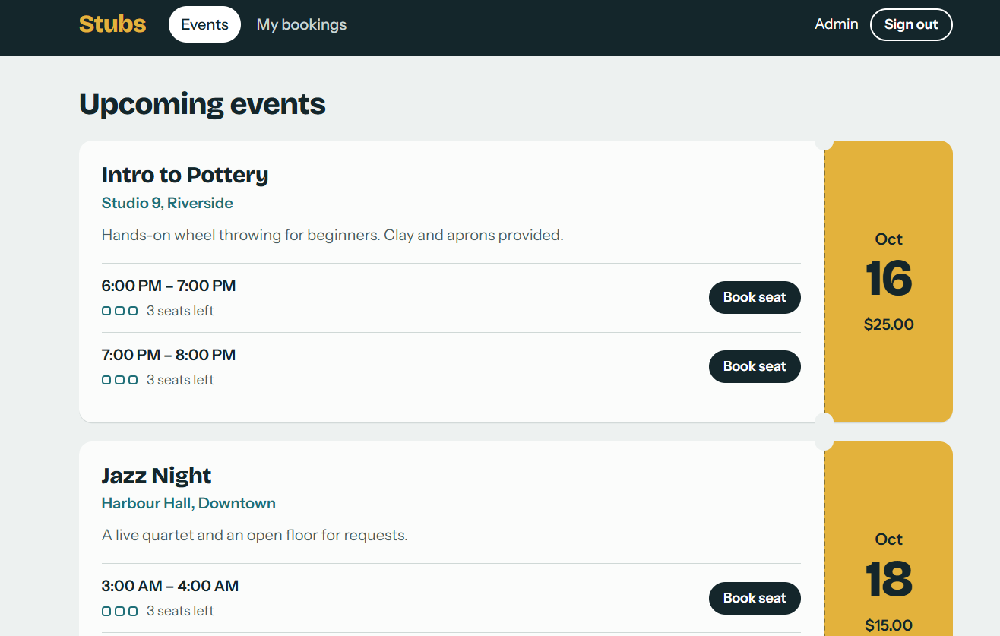

# Stubs: event booking system
   
React + Vite frontend on a Supabase (Postgres) backend.

What the database enforces, not the UI:

- **No double-booked venues:** an exclusion constraint rejects overlapping events in the same venue.
- **No overselling:** `book_slot()` locks the slot row, checks seats, and inserts in one transaction.
- **One active booking per user per slot:** a partial unique index.
- **Status flow:** a trigger blocks reopening cancelled bookings.
- **Row Level Security:** users see only their own bookings; only admins write venues, events, and slots.

## Run it on localhost

### 1. Prerequisites
- Node.js 18 or newer (`node -v`)
- A free Supabase account: https://supabase.com

### 2. Create the Supabase project
1. Create a new project in the Supabase dashboard and wait for it to finish provisioning.
2. Open **Project Settings → API** and copy the **Project URL** and the **anon / publishable key**.

### 3. Create the database
1. Open **SQL Editor → New query**.
2. Paste the full contents of `supabase/migrations/20261013000000_init.sql` and click **Run**.
3. New query again: paste `supabase/seed.sql` and click **Run** (sample venues, events, and slots).

### 4. Make signup easy for local testing
Open **Authentication → Providers → Email** and turn **Confirm email** off, so you can sign in right after signing up. Turn it back on before you deploy.

### 5. Configure the app
```bash
cp .env.example .env
```
Edit `.env` and paste your URL and key:
```
VITE_SUPABASE_URL=https://xxxxxxxx.supabase.co
VITE_SUPABASE_ANON_KEY=your-key
```

### 6. Install and start
```bash
npm install
npm run dev
```
Open http://localhost:5173.

### 7. Make yourself an admin
1. Sign up in the app.
2. In the Supabase **SQL Editor**, run (use your own email):
```sql
update public.profiles
set role = 'admin'
where id = (select id from auth.users where email = 'you@example.com');
```
3. Refresh the app. An **Admin** tab appears.

## Test the database rules

| Try this | Expected result |
| --- | --- |
| Book a slot with 3 seats using 3 different accounts, then a 4th | "This slot is full" |
| Book the same slot twice with one account | "You have already booked this slot" |
| Admin: add an event in the same venue overlapping another event | "That venue already has an event during this time." |
| Cancel a booking, then book again | Works; the seat is freed |
| In the browser console, try `supabase.from('events').insert(...)` as a normal user | Blocked by RLS |

## Project structure

```
supabase/
  migrations/20261013000000_init.sql   schema, constraints, RLS, functions
  seed.sql                             sample data
src/
  lib/supabase.js                      client setup
  components/                          Events, MyBookings, Admin, AuthForm, Seats
  App.jsx, styles.css
```

## Push to GitHub

```bash
git init
git add .
git commit -m "Event booking system"
git branch -M main
git remote add origin https://github.com/YOUR-USER/event-booking.git
git push -u origin main
```
`.env` is git-ignored. Only `.env.example` is committed.

## Optional: run Supabase locally with Docker

If you prefer a fully local database: install Docker and the Supabase CLI, run `supabase init`, copy the migration into `supabase/migrations/`, run `supabase start`, then `supabase db reset` (it applies the migration and `seed.sql`). Use the local API URL and anon key printed by `supabase start` in your `.env`.
